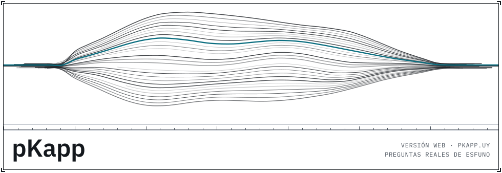
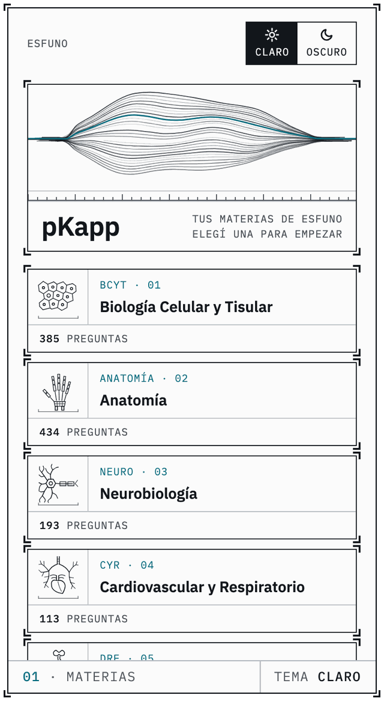
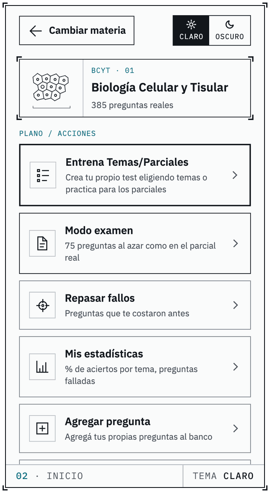
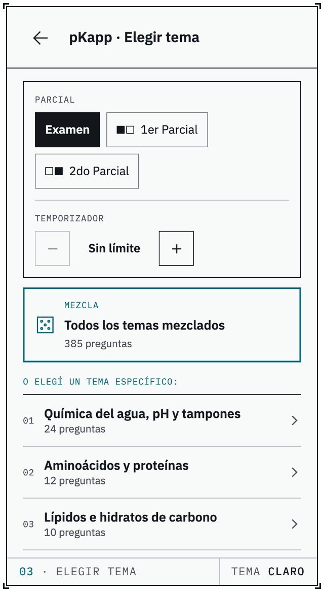
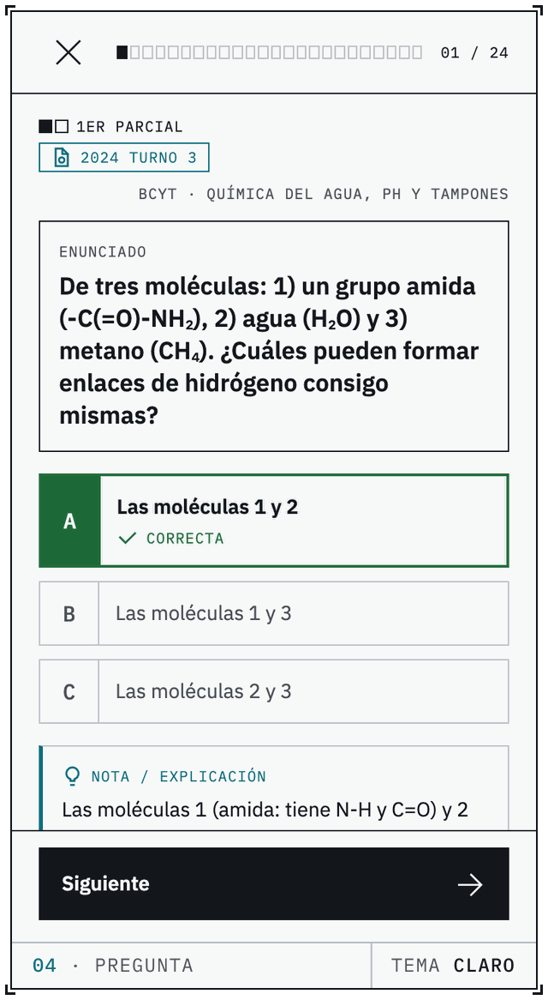
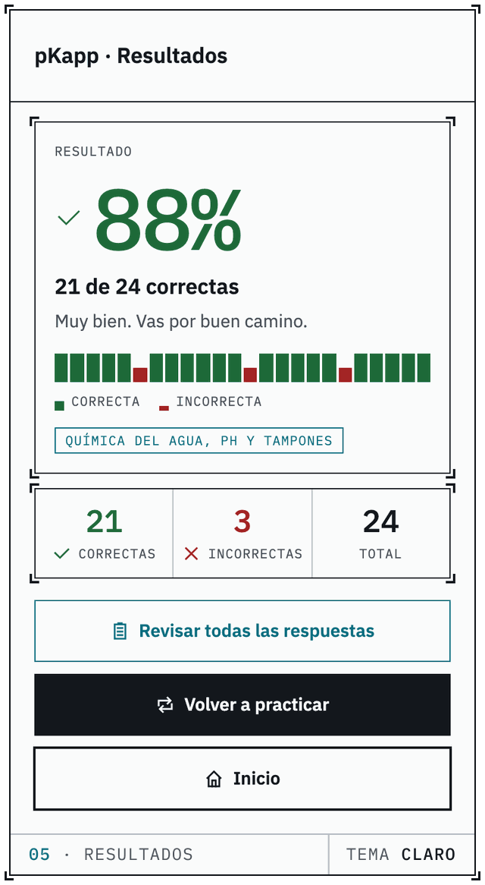
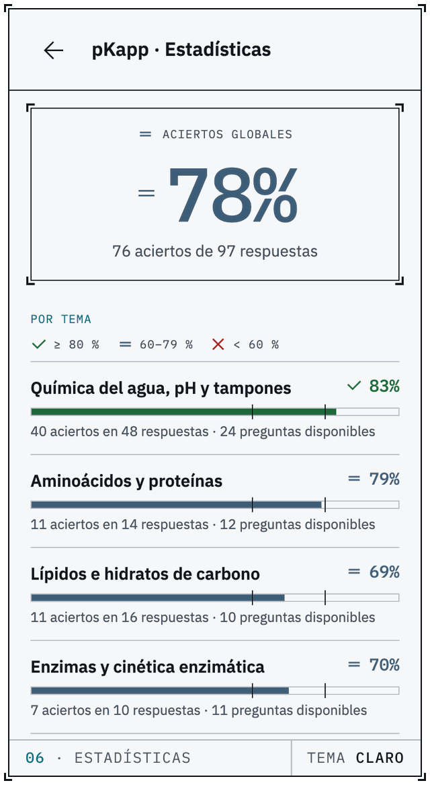
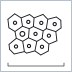
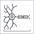
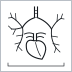

<p align="center">
  <picture>
    <source media="(prefers-color-scheme: dark)" srcset="docs/readme/portada-oscuro.svg">
    
  </picture>
</p>

# pKapp · versión web

[pkapp.uy](https://pkapp.uy)

pKapp nació para acompañar a mi pareja en el estudio y terminó siendo útil para más personas. La idea era simple: resolver una necesidad concreta de preparación con preguntas reales, explicaciones claras y un flujo de repaso que no perdiera contexto.

La versión web mantiene esa intención, pero pensada para funcionar en navegador y sentirse como una app: accesible, portable y útil en la vida cotidiana. No se construyó para parecer algo grande desde el principio; se construyó para resolver un problema real y seguir creciendo sin perder claridad.

Debo decir que la arquitectura no es la que me gustaría: dado lo espontáneo que fue todo, hay decisiones que no habría tomado de haber sabido qué tanta gente usaría la app, aunque me alegra que haya sido útil. Posteriormente fui corrigiendo muchas cosas y aún me encuentro en esa tarea.

La forma de trabajar en este proyecto está guiada por un enfoque de **Spec Driven Development**: cada cambio nace de una necesidad, se define con intención y se implementa con criterio. La prioridad no es sumar funciones por sumar; es mantener una base útil, coherente y fácil de sostener.

> Es gratis, y va a serlo mientras pueda mantenerla.

Construido con **Expo / React Native**. Esta es la **versión web** del proyecto: corre en navegadores modernos (versiones mínimas en [Navegadores recomendados](#navegadores-recomendados)) y se puede instalar como **PWA** (Progressive Web App) en escritorio, Android e iOS.

> Si buscás la versión nativa (iOS / Android), está en [pKapp](https://github.com/agustinfrusto/pKapp).

## Capturas

<p align="center">
  <picture><source media="(prefers-color-scheme: dark)" srcset="docs/screenshots/01-materia-select-390-oscuro.png"></picture>
  <picture><source media="(prefers-color-scheme: dark)" srcset="docs/screenshots/02-home-390-oscuro.png"></picture>
  <picture><source media="(prefers-color-scheme: dark)" srcset="docs/screenshots/03-topic-select-390-oscuro.png"></picture>
</p>
<p align="center">
  <picture><source media="(prefers-color-scheme: dark)" srcset="docs/screenshots/04-quiz-390-oscuro.png"></picture>
  <picture><source media="(prefers-color-scheme: dark)" srcset="docs/screenshots/05-results-390-oscuro.png"></picture>
  <picture><source media="(prefers-color-scheme: dark)" srcset="docs/screenshots/06-stats-390-oscuro.png"></picture>
</p>

<sub>Las cifras de Resultados y de Estadísticas son de ejemplo: salen de una sesión simulada.</sub>

## Qué hace pKapp

pKapp está pensado para estudiar de forma práctica y enfocada. La app ayuda a repasar materias de ESFUNO —BCYT, Anatomía, Neurobiología, Cardiovascular y Respiratorio, Digestivo, Renal y Endócrino, y Reproductor y Desarrollo— con un banco de preguntas estructurado, explicaciones útiles y seguimiento del desempeño.

| | Materia | Banco | Examen | Parcial |
|---|---|--:|--:|--:|
| <picture><source media="(prefers-color-scheme: dark)" srcset="docs/readme/materias/bcyt-oscuro.svg"></picture> | **Biología Celular y Tisular** (BCYT) | 385 | 75 | 40 |
| <picture><source media="(prefers-color-scheme: dark)" srcset="docs/readme/materias/anatomia-oscuro.svg"></picture> | **Anatomía** | 434 | 50 | 25 |
| <picture><source media="(prefers-color-scheme: dark)" srcset="docs/readme/materias/neuro-oscuro.svg"></picture> | **Neurobiología** | 193 | 25 | — |
| <picture><source media="(prefers-color-scheme: dark)" srcset="docs/readme/materias/cyr-oscuro.svg"></picture> | **Cardiovascular y Respiratorio** (CyR) | 113 | 50 | — |
| <picture><source media="(prefers-color-scheme: dark)" srcset="docs/readme/materias/dre-oscuro.svg"></picture> | **Digestivo, Renal y Endócrino** (DRE) | 451 | 50 | — |
| <picture><source media="(prefers-color-scheme: dark)" srcset="docs/readme/materias/ryd-oscuro.svg"></picture> | **Reproductor y Desarrollo** (RyD) | 172 | 20 | — |
| | **Total** | **1.748** | | |

<sub>Banco: preguntas disponibles, sin repetidas. Examen: preguntas del modo examen, con el tamaño del examen real. Parcial: preguntas del examen cuando se filtra por un parcial; solo BCYT y Anatomía tienen parciales, las demás son de examen único (—).</sub>

## Características

- **Multimateria** (ESFUNO): hoy con **Biología Celular y Tisular** (BCYT), **Anatomía**, **Neurobiología**, **Cardiovascular y Respiratorio** (CyR), **Digestivo, Renal y Endócrino** (DRE) y **Reproductor y Desarrollo** (RyD). Estructura preparada para sumar los demás módulos.
- **Banco de preguntas** con material real de exámenes en todas las materias: BCYT, Anatomía, Neurobiología, CyR, DRE y RyD.
- **1.748 preguntas reales**, sin repetidas, extraídas de parciales, exámenes y prototipos oficiales (BCYT 2022/2024/2025: 385 · Anatomía 2018-2025: 434 · Neurobiología: 193 · CyR: 113 · DRE: 451 · RyD: 172).
- **Tres modos de estudio** (tabla de abajo).
- **Filtros** combinables: por fuente (todas o solo las tuyas) y por parcial. El detalle está en [Cómo funciona el filtrado de preguntas](#cómo-funciona-el-filtrado-de-preguntas).
- **Temporizador** opcional, de 10 a 120 minutos en saltos de 10 (por defecto, sin límite). Cuenta contra un plazo fijado al empezar, no por ticks: sigue corriendo con la pantalla bloqueada o la pestaña en segundo plano y se recalcula al volver. Cuando vence, pasa a Resultados con las respuestas dadas hasta ese momento.
- **Explicaciones** tras cada respuesta, o solo al final del cuestionario si activás «Ocultar resultado hasta el final» en Ajustes. La revisión de Resultados siempre las muestra.
- **Estadísticas** de la materia activa: porcentaje de aciertos por tema, en tres bandas (80 % o más, de 60 a 79 %, menos de 60 %), y la lista de las diez preguntas más falladas.
- **Preguntas propias**: se agregan desde Inicio, en «Agregar pregunta» (de 2 a 6 opciones y explicación opcional), se guardan solo en tu navegador y se administran en Ajustes, en «Mis preguntas». Suman al banco de la materia y habilitan el filtro «Solo mías».
- **Respaldo del progreso**: en Ajustes, «Descargar respaldo» genera un archivo JSON con estadísticas, preguntas propias y ajustes de todas las materias, y «Importar respaldo» lo restaura. Al importar valida la versión del archivo y que cada dato sea JSON válido, descarta lo que no lo es, ignora las claves que no son de pKapp y conserva lo que ya existe en ese navegador.
- **Tema claro y oscuro**, que se cambia desde el encabezado del selector de materias y de Inicio y se recuerda entre sesiones. Por defecto es el claro: la app no sigue la preferencia del sistema.
- **PWA instalable** en escritorio, Android e iOS, con ícono propio y experiencia tipo app.

### Modos de estudio

| Modo | En la app | Qué hace |
|---|---|---|
| Práctica por tema | <kbd>Entrena Temas/Parciales</kbd> | Un tema a elección o <kbd>Todos los temas mezclados</kbd>, con el parcial como filtro opcional. |
| Examen | <kbd>Modo examen</kbd> | Preguntas al azar con el tamaño del examen real, que cada materia define en `src/materias/<id>/config.js` (columnas Examen y Parcial de la tabla de materias). |
| Repaso de fallos | <kbd>Repasar fallos</kbd> | Las preguntas que erraste alguna vez y todavía no acertaste dos veces seguidas. |

## Cómo funciona el filtrado de preguntas

Cada pregunta tiene un campo `source`:
- `"exam"` → pregunta real extraída de un parcial anterior (con campo `exam` indicando cuál).
- `"generated"` → pregunta generada a partir de los apuntes. Hoy ningún banco publicado tiene preguntas de este tipo.
- `"user"` → pregunta agregada por el usuario.

En `TopicSelectScreen` hay hasta tres controles combinables, según la materia y tus datos:

**Fuente**, solo si la materia tiene al menos una pregunta tuya:
- **Todas** (default).
- **Solo mías** → filtra `source === 'user'`. Tus preguntas no traen parcial: combinadas con un parcial no devuelven nada, y la app te propone volver a **Examen**.

**Parcial**, solo en las materias con parciales (BCYT y Anatomía):
- **Examen** (default) → sin filtro de parcial. En modo examen sortea `examSize` preguntas.
- **1er Parcial** → filtra `parcial === 'primero'`. En modo examen sortea `examSizeParcial` preguntas.
- **2do Parcial** → filtra `parcial === 'segundo'`.

Los tamaños de cada materia están en la tabla de [Qué hace pKapp](#qué-hace-pkapp) y se definen en `src/materias/<id>/config.js`. En práctica por tema el parcial filtra sin tope.

**Temporizador**, siempre, al final:
- Stepper con **Sin límite** (default) y de 10 a 120 minutos, en saltos de 10. Rige en los tres modos.
- El plazo se fija al empezar el cuestionario y el tiempo restante se calcula contra él. Al vencer navega automáticamente a Resultados con las respuestas dadas hasta el momento.

## Cómo se construye pKapp

Este proyecto no se construye como una lista interminable de features. La idea es simple: cada cambio parte de una necesidad real y se define antes de implementarse.

### Principios

- Cada funcionalidad nace de un problema concreto.
- Antes de construir, se define el comportamiento esperado.
- Se validan decisiones de UX, arquitectura y contenido.
- La documentación acompaña la implementación, en vez de quedar como deuda posterior.
- La mantenibilidad pesa más que la cantidad de cosas visibles.

Esto hace que el proyecto se sienta más estable y más honesto: no se suma por sumar, se mejora con criterio.

## Temas cubiertos

<details>
<summary><b>Biología Celular y Tisular (BCYT)</b></summary>

**1er parcial:** Química del agua, pH y tampones · Aminoácidos y proteínas · Lípidos e hidratos de carbono · Enzimas y cinética enzimática · Metabolismo celular · Membrana biológica · Organelos celulares · Microscopía · Transporte a través de membranas · Potencial de acción · División celular y cromosomas · Reparación del ADN y radiobiología.

**2do parcial:** Genética y herencia · ADN, ARN y síntesis proteica · Tejido epitelial · Tejido conjuntivo · Tejido cartilaginoso · Tejido óseo · Tejido muscular (histología) · Sangre y hemopoyesis · Tejido linfoideo · Ciclo celular y reparación ADN · Contracción muscular · Palancas y biomecánica · Radioprotección · Hemostasis y coagulación · Sistema inmune.

</details>

<details>
<summary><b>Anatomía</b></summary>

Sistema nervioso central · Nervios periféricos y plexos · Sistema muscular · Osteología · Sistema vascular periférico · Cabeza y cuello · Tórax y mediastino · Abdomen · Pelvis y periné.

</details>

<details>
<summary><b>Neurobiología</b></summary>

Organización del sistema nervioso · Neurona: tipos, prolongaciones y organelos · Glía (astrocitos, microglía, oligodendrocitos) · Mielina y nervio periférico · Potencial de membrana y de acción · Sinapsis y transmisión · Receptores sensoriales y transducción · Vías somatosensoriales y corteza · Reflejos, husos y órgano de Golgi · Control motor y cortezas motoras · Sistema nervioso autónomo · Médula espinal · Cerebelo · Corteza cerebral e hipocampo.

Materia sin parciales (examen único).

</details>

<details>
<summary><b>Cardiovascular y Respiratorio (CyR)</b></summary>

Fisiología cardíaca, ciclo y gasto cardíaco · Bases del electrocardiograma y dipolo · Hemodinamia, presión arterial y resistencias · Circulaciones regionales y microcirculación · Mecánica ventilatoria, presiones y compliance · Difusión de gases, transporte O2/CO2 y V/Q · Control de la respiración y quimiorreceptores · Histología cardiovascular y respiratoria.

Materia sin parciales (examen único).

</details>

<details>
<summary><b>Digestivo, Renal y Endócrino (DRE)</b></summary>

Motilidad, secreciones, digestión y absorción · Histología del tubo digestivo y glándulas anexas · Filtración, función tubular y balance hidrosalino · Histología renal y de glándulas endócrinas · Ejes endócrinos, hormonas y señalización · Metabolismo energético, ayuno e ingesta · Lipoproteínas, tejido adiposo y síndrome metabólico · Recambio proteico, aminoácidos y ciclo de la urea · Equilibrio ácido-base.

Materia sin parciales (examen único).

</details>

<details>
<summary><b>Reproductor y Desarrollo (RyD)</b></summary>

Histología masculina y espermatogénesis · Histología femenina y ovogénesis · Glándula mamaria y lactancia · Eje hipotálamo-hipófiso-testicular y respuesta sexual · Eje hipotálamo-hipófiso-ovárico y ciclo sexual · Fecundación, segmentación e implantación · Gastrulación, hojas embrionarias y notocorda · Placenta y anexos embrionarios · Diferenciación, inducción y genes del desarrollo.

Materia sin parciales (examen único).

</details>

## Cómo instalar la PWA

**Escritorio (Chrome / Edge):** click en el ícono de "Instalar" en la barra de direcciones.

**Android (Chrome):** menú del navegador (tres puntos) → "Add to Home screen" / "Instalar aplicación".

**iOS (Safari):** botón Compartir → "Add to Home Screen". Una vez instalada, los datos persisten correctamente (escapando de las limitaciones de ITP).

## Navegadores recomendados

### Versiones mínimas

| Navegador | Desde la versión |
|---|--:|
| Safari / iOS | 15.4 |
| Chrome / Edge | 93 |
| Firefox | 92 |
| Samsung Internet | 17 |

Es el piso que fija el proyecto (`openspec/config.yaml`): el código usa lo que traen esas versiones, sin polyfills.

### Persistencia

| Navegador | Persistencia | Veredicto |
|-----------|--------------|-----------|
| Chrome / Edge / Firefox (desktop) | Excelente | **Recomendado** |
| Chrome / Edge (Android) | Excelente | **Recomendado** |
| Safari (desktop) | Buena | Funciona pero ITP puede borrar datos tras semanas sin uso |
| Safari / Chrome (iOS) | Limitada en navegador, excelente como PWA instalada | **Instalar como PWA** |

## Plataforma web

| | Web |
|--|--|
| **Persistencia** | `localStorage` (`src/db/database.web.js`) |
| **Confirmaciones** | `window.confirm` (envuelto en `src/utils/confirm.js`) |
| **Analytics** | Cloudflare Web Analytics (páginas) + Umami (eventos, sin cookies) |
| **Distribución** | Cloudflare Pages (deploy automático en cada `git push`) |

### Sobre la persistencia en web

Todo se guarda en `localStorage` del navegador. Los datos persisten entre sesiones, pero:
- Son locales a cada navegador (no se sincronizan entre dispositivos). Para llevarlos a otro, está el respaldo de Ajustes.
- Si el usuario borra los datos del sitio o usa modo incógnito, se pierden.
- En iOS Safari (sin instalar la PWA), Apple borra `localStorage` tras 7 días de inactividad (ITP). Instalando la app desde el home screen, este límite desaparece.

## Estructura del proyecto

```text
.
├── App.js                          # Navegación y proveedores (materia, tema)
├── index.js                        # Entry point Expo
├── app.json                        # Config Expo (incluye sección web/PWA)
├── metro.config.js                 # Metro: NativeWind, woff2 y shim de decode-uri-component
├── babel.config.js
├── tailwind.config.js              # Tokens visuales: colores, escalas y cortes de escritorio
├── global.css                      # Directivas de Tailwind
├── package.json
├── .node-version                   # Node 22
├── public/                         # Archivos servidos en la raíz del sitio web
│   ├── manifest.json               # Manifest PWA
│   ├── icon-192.png, icon-512.png, icon-maskable-512.png, apple-touch-icon.png
│   ├── favicon.ico, favicon.png, favicon-16.png, favicon-32.png
│   ├── _redirects                  # SPA fallback (Cloudflare Pages)
│   └── _headers                    # Security headers (Cloudflare Pages)
├── scripts/
│   ├── verificar-avisos.mjs        # Pre-build: valida la lista de avisos
│   ├── gen-conteos.mjs             # Pre-build: genera src/materias/conteos.js
│   ├── inject-pwa.js               # Post-build: inyecta meta tags PWA, CF Analytics y Umami
│   ├── verificar-bundle.mjs        # Post-build: falla si el bundle trae la página de prueba
│   └── capturar-screenshots.js     # Capturas de pantalla (npm run screenshots)
├── tools/                          # Herramientas de desarrollo (fuera del bundle)
│   ├── ingesta/                    # Pipeline Python: extraer, validar y enriquecer preguntas
│   ├── e2e/                        # Arnés de navegación web sobre CDP
│   └── ui/                         # Chequeos de UI y generadores de ilustraciones y glifos
├── openspec/                       # Specs y changes (Spec Driven Development)
│   └── diseno/                     # Sistema de diseño Plancha: tokens, fichas y SVG
├── docs/
│   ├── screenshots/                # Láminas de las capturas de este README (claro y oscuro)
│   └── readme/                     # Portada, miniaturas de materia y su generador
└── src/
    ├── materias/                   # Registro de materias (ESFUNO)
    │   ├── index.js                # MATERIAS y MATERIA_LIST
    │   ├── conteos.js              # GENERADO: preguntas por materia, sin repetidas
    │   ├── dedupe.js               # Descarta las preguntas repetidas del banco
    │   └── <id>/                   # bcyt, anatomia, neuro, cyr, dre y ryd
    │       ├── index.js
    │       ├── metadata.js         # id, nombre, nombre corto, descripción, available
    │       ├── config.js           # examSize, parciales, etc.
    │       ├── topics.js           # TOPICS de la materia
    │       ├── ilustracion.js      # Ilustración de la materia (GENERADO)
    │       └── questions.js        # Banco de preguntas
    ├── materia/MateriaContext.js   # Estado: materia activa, getter de data
    ├── db/database.web.js          # Persistencia (localStorage)
    ├── navigation/linking.js       # Deep linking web: botón Atrás y URLs por pantalla
    ├── avisos/avisos.js            # Lista de avisos descartables del selector de materias
    ├── components/
    │   ├── plancha/                # Sistema Plancha: lámina, tarjetas, segmentos y más
    │   ├── BarraInterna.js         # Barra superior de las pantallas internas
    │   ├── DonationBox.js          # Pedido de donación (Mercado Pago)
    │   ├── Glifo.js                # Glifos de interfaz (SVG de trazo)
    │   ├── HeaderMarca.js          # Header compartido (control de tema y acción izquierda)
    │   ├── Ilustracion.js          # Dibuja ilustraciones y glifos SVG desde datos
    │   └── RegionAvisos.js         # Región de avisos de una pantalla
    ├── theme/
    │   ├── colores.js              # Tokens de color del sistema visual
    │   ├── fuentes.web.js          # Carga de las fuentes IBM Plex
    │   └── TemaContext.js          # Contexto de tema claro u oscuro
    ├── utils/
    │   ├── confirm.js              # Confirmaciones cross-platform
    │   ├── donacion.js             # Métricas del embudo de donación
    │   ├── migration.js            # Respaldo: exportar e importar el progreso
    │   ├── mercadopago.js          # Links de donación (Mercado Pago)
    │   ├── report.js               # Reporte de preguntas (mailto a soporte)
    │   ├── track.js                # Eventos de analítica (Umami)
    │   └── webStyles.js            # Inyección de CSS para web (hover y foco)
    ├── shims/decode-uri-component.js
    ├── assets/
    │   ├── fuentes/                # IBM Plex en woff2 y su licencia (OFL.txt)
    │   ├── filamentos.js           # Campo de filamentos de la cabecera del selector
    │   ├── glifos.js               # Glifos de interfaz (GENERADO)
    │   └── logo.png, icon.png      # Logo e ícono de la app
    └── screens/
        ├── MateriaSelectScreen.js  # Pantalla inicial: elegí materia
        ├── HomeScreen.js           # Menú principal de la materia
        ├── TopicSelectScreen.js    # Selector de tema + filtros + timer
        ├── QuizScreen.js           # Quiz en sí
        ├── ResultsScreen.js        # Resultados + revisión
        ├── AddQuestionScreen.js    # Formulario para agregar preguntas
        ├── StatsScreen.js          # Estadísticas
        └── SettingsScreen.js       # Ajustes (resultado al final, propias, respaldo, reseteo)
```

## Desarrollo

Requiere Node 22 (versión fijada en `.node-version`).

```bash
# instalar dependencias (instalación reproducible desde package-lock.json)
npm ci

# correr en navegador
npm run web

# build completo (output: dist/)
npm run build:web

# regenerar los conteos por materia (también corre dentro de build:web)
npm run conteos

# recorrido e2e de navegación web (antes corre pree2e: los chequeos de tools/ui)
npm run e2e

# capturas crudas de las seis pantallas (ver «Imágenes del README»)
npm run screenshots
```

`build:web` corre, en orden: `scripts/verificar-avisos.mjs`, `scripts/gen-conteos.mjs`, `expo export -p web`, `scripts/inject-pwa.js` y `scripts/verificar-bundle.mjs`.

### Imágenes del README

La portada y las miniaturas de materia (`docs/readme/`) y las láminas de las capturas (`docs/screenshots/`) las genera `docs/readme/generar.mjs` con los tokens de `src/theme/colores.js`; el texto de los SVG sale de las fuentes IBM Plex convertido a trazos. La portada y las miniaturas solo piden Node; las láminas de las capturas piden además `rsvg-convert` y Python con Pillow:

```bash
npm run build:web
npm run screenshots -- --tema claro --ancho 390 --salida <carpeta>
npm run screenshots -- --tema oscuro --ancho 390 --salida <carpeta>
node --no-warnings docs/readme/generar.mjs --capturas <carpeta>
```

### Versionado

Semver según el prefijo del commit (aplicado a partir de `v1.0.33`; hasta la `v1.0.32` se usaba patch para todo):

- `feat` → minor (1.**x**.0)
- `fix` / `refactor` / `style` / `chore` → patch (1.0.**x**)
- breaking change → major

Solo cambia la versión un commit que toca la app publicada (`src/`, `public/`, `scripts/`, `App.js` o la configuración de build). Los commits de documentación, specs y herramientas no la cambian. El procedimiento completo está en [`openspec/commit.md`](openspec/commit.md).

Cada release se taggea `vX.Y.Z`. La versión vive en `package.json` **y** `app.json` (esta última es la que se muestra en Ajustes → Acerca de).

### Deploy

El proyecto se sirve desde **Cloudflare Pages** en [pkapp.uy](https://pkapp.uy). Cada `git push` a `main` redeploya automáticamente.

La migración desde el host anterior (**Vercel**, dominio `pkapp-web.vercel.app`) ya está completa y el proyecto de Vercel fue dado de baja: el sitio vive 100% en Cloudflare Pages.

## Uso de IA en el proyecto

Por transparencia, detallo en qué partes del proyecto se usó asistencia de IA (principalmente **Claude**, familia Opus).

### Contenido educativo

- **1.748 preguntas reales** extraídas de parciales, exámenes y prototipos oficiales. Se usó IA como apoyo para transcribir y limpiar los PDFs originales. La respuesta correcta de cada pregunta se toma del documento fuente y se contrasta con una validación ciega hecha por IA; las preguntas en las que ambas no coinciden, o que resultan ambiguas, se revisan manualmente antes de publicarse.
- **Preguntas generadas:** BCYT llegó a tener 34 preguntas generadas a partir de los apuntes oficiales. Se retiraron en octubre de 2026: hoy todos los bancos son de exámenes reales.
- **Explicaciones:** redactadas o refinadas con IA tomando como referencia los resúmenes oficiales, priorizando precisión y consistencia con el material de estudio.

### Código

Asistencia para refactors, debugging, configuración del soporte web (PWA, capa de persistencia en `database.web.js`), deploy en Cloudflare Pages y revisión de patrones.

### Lo que NO se delegó a IA

- La curaduría de qué preguntas reales incluir y de qué exámenes provienen.
- Las decisiones de diseño, arquitectura, UX y la revisión final de cada cambio.

## Créditos

**Tipografía:** [IBM Plex](https://github.com/IBM/plex) Sans y Mono, © IBM Corp., bajo la licencia SIL Open Font License 1.1 ([`src/assets/fuentes/OFL.txt`](src/assets/fuentes/OFL.txt)).

## Licencia

> **El contenido de estudio (preguntas, explicaciones, material didáctico)
> está bajo licencia [CC BY-NC-SA 4.0](LICENSE-CONTENT).
> Esto significa que NO está permitido el uso comercial.**

Este proyecto usa licencias separadas:

| Componente | Licencia | Uso comercial |
|------------|----------|---------------|
| Código fuente | [MIT](LICENSE) | Permitido |
| Contenido educativo | [CC BY-NC-SA 4.0](LICENSE-CONTENT) | Prohibido |

### ¿Qué significa esto en la práctica?

**Podés:**
- Forkear el repo y usar el código para hacer tu propia app
- Estudiar con la app gratuitamente
- Compartirla con otros estudiantes
- Contribuir con mejoras

**No podés:**
- Vender la app o el material en plataformas de pago
- Incluir el contenido en cursos pagos sin autorización
- Usar las preguntas en productos comerciales
